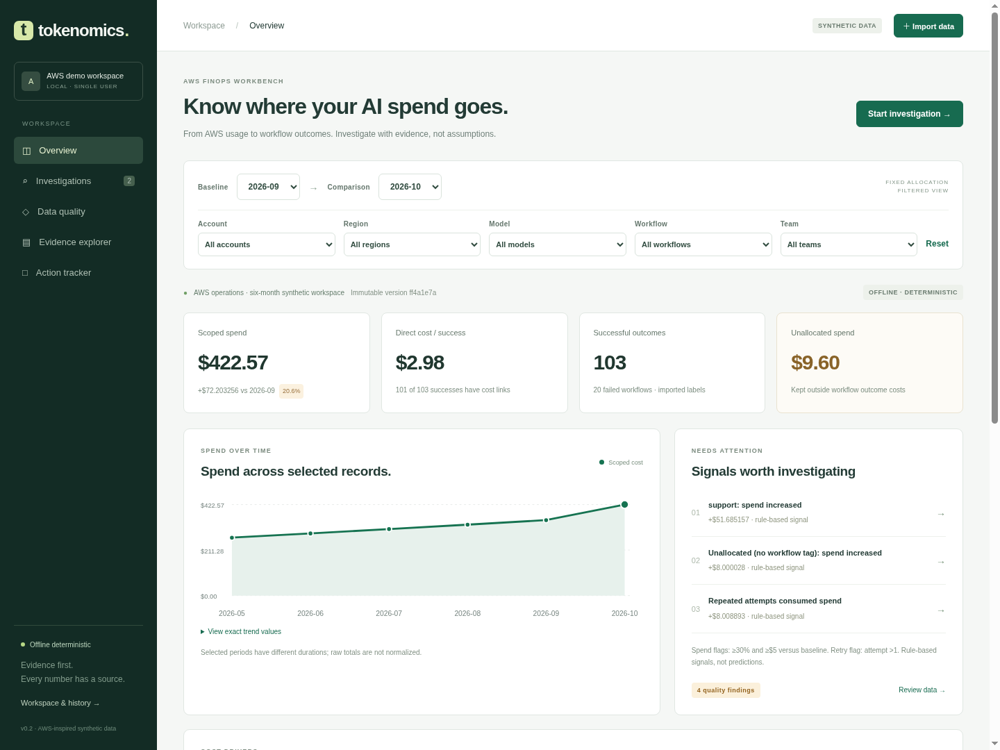

# Tokenomics investigation workbench

An AWS-first, evidence-backed AI FinOps workbench for a **local single user**. Follow synthetic billing and Bedrock-style usage through reconciliation, allocation, variance investigation and workflow outcomes. Save investigations, inspect exact source records, and track review actions with history.

This is a substantial working preview, not a production-readiness claim. The shipped app is **offline and deterministic**. It makes no AWS or model calls, discovers no credentials, and executes no cloud changes.

## Run locally

Requires **Node.js 22.13+** (tested locally on Node 22.13.0 and Node 24.19.0) and npm. SQLite is supplied by Node; no database service is needed. Node 22 may print an experimental SQLite warning.

```sh
npm ci --ignore-scripts
npm start
# Open http://127.0.0.1:3000
```

Windows PowerShell, from this repository:

```powershell
node --version
npm.cmd ci --ignore-scripts
npm.cmd start
```

On first launch, the app seeds six months of synthetic AWS records, two saved investigations and one proposed review action. Stop with Ctrl+C. Restarting restores the workspace. No API key is needed. The offline app itself can start without npm dependencies; installation provides lint/format gates and the optional SDK adapter.

`PORT=3001 npm start` changes the port on Unix. In PowerShell, use `$env:PORT = '3001'` before starting. The server binds to `127.0.0.1` only.

## Explore the release

1. **Overview:** select comparison periods and account, region, model, workflow or team. Inspect spend trends, rule-based anomaly signals and additive cost drivers.
2. **Investigations:** open a seeded case or ask a suggested question. Watch the visible tool steps, inspect calculations and click a source-record link. Supported results save automatically with the original scope and dataset version.
3. **Data quality:** examine positive/negative billing gaps, unallocated spend, missing outcome links and the shared allocation ledger. The screen explicitly labels the broader scope of reconciliation checks.
4. **Evidence explorer:** search and paginate imported usage, billing and outcome records; inspect exact JSON or export a dataset.
5. **Action tracker:** track an investigation recommendation, assign a local owner and update status/notes. These are review tasks, not automated changes or verified savings.
6. **Workspace & history:** activate earlier datasets, clear the active view without deleting saved work, and inspect audit events.

The guided question interface uses four explicit keyword-routed intents: spend variance, retries/failures, billing quality, and outcome cost. It is not arbitrary natural-language understanding. Periods and dimensions come from the selected controls, not from free-text dates. Unsupported requests are rejected without saving a fabricated answer.

## Preview



[Investigation](docs/screenshots/desktop-investigation.png) · [Detailed findings](docs/screenshots/desktop-investigation-findings.png) · [Data quality](docs/screenshots/desktop-quality.png) · [Mobile overview](docs/screenshots/mobile-overview.png) · [Mobile investigation](docs/screenshots/mobile-investigation.png)

Screenshots are from automated Chromium runs against a disposable local workspace. The browser script recreates them.

## Financial and evidence guarantees within this scope

- Monetary inputs are integer **microdollars**: 1 USD = 1,000,000 `micros`. Aggregation preserves sub-cent requests; display cards round to cents, while tables and source records expose up to six decimals.
- Shared costs are allocated **before filtering**, separately within each period/account/region. Workflow/team weights use tagged, non-shared token volume. Largest remainder conserves every microdollar with stable tie-breaking. No eligible weight leaves a shared source unallocated.
- Scoped workflow totals project that fixed ledger. Filters never silently redistribute costs. Model-group and other dimensional contributions sum to the exact observed spend change.
- Model-level token-volume decomposition holds the baseline observed blended cost/token fixed; the remaining rate/mix residual conserves the delta. Integer rational arithmetic and `BigInt` multiplication prevent intermediate rounding loss. Unsafe counterfactual projections are omitted rather than rounded into an inaccurate number. This is not causal price attribution.
- Reconciliation is billed cost minus matched invocation cost, including negative gaps. Invoice summaries must equal billing lines; usage mismatches remain visible. Billing has no trustworthy model/workflow/team attribution, so reconciliation uses only account and region filters.
- Direct cost per successful outcome divides costs linked to successful outcomes, including their retries, by successful outcomes. Fully allocated cost per success also includes failed-workflow spend and shared allocation. Neither is ROI or business value. Missing links are explicit. Model-filtered outcome denominators are unavailable rather than invented.
- Investigations retain an immutable SHA-256 dataset version, scope, computed findings and valid source IDs. Viewing another dataset does not silently change saved evidence.

The fixture's September/October comparison is tested against explicit expected values:

| Measure                                        |   September |                 October |
| ---------------------------------------------- | ----------: | ----------------------: |
| Observed spend                                 | $350.363213 |             $422.566469 |
| Unallocated spend                              |   $1.600006 |               $9.600034 |
| October spend change                           |           — |             +$72.203256 |
| October successful outcomes / linked successes |           — |               103 / 101 |
| Direct successful-outcome cost numerator       |           — |             $307.095188 |
| Repeated-attempt spend                         |           — |               $8.008893 |
| October account 1 / account 2 billing gaps     |           — | +$7.250011 / −$1.250003 |

September has 30 days and October 31. The UI warns that raw totals are not duration-normalized.

## Imports and data boundaries

[Schema and policies](docs/DATA_CONTRACT.md) describes the complete contract and limitations. `fixtures/workbench.json` is schema v2: six periods, two fictional accounts, two regions, three workflows, 676 usage rows, and 648 outcomes. Regenerate deterministically with `npm run fixture`. The original two-period `fixtures/support.json` remains as a v1 compatibility fixture.

These are **simplified custom AWS billing-export/CUR-inspired and Bedrock invocation-style schemas**, not full CUR compatibility, actual AWS exports, live connections or current AWS pricing. Fixed sample costs and model names are illustrative. Only synthetic USD imports are accepted; the `synthetic` flag is a user assertion, not a reliable classifier of sensitive data.

## Persistence and local security

By default data lives in `.local/tokenomics.sqlite`, excluded from Git. `TOKENOMICS_DATA_DIR` selects a different local directory. SQLite transactions, foreign keys, WAL and full synchronous commits protect related updates; action version checks reject stale edits. Investigation request IDs are persisted with their results: retries return the original case, and reusing an ID for different input is rejected. Import failure retains the previous dataset. Identical raw JSON content deduplicates by hash.

This boundary is **local single-user**, without production authentication, tenant isolation, encryption-at-rest or a tamper-proof audit service. Someone with access to the machine/database can read or change it. The app rejects non-loopback hosts and foreign origins, requires a per-process token for writes, uses parameterized SQL, escapes rendered content and serves a restrictive CSP. These are tested controls, not a completed security assessment.

To back up, stop the app cleanly, then copy the entire data directory. Do not copy only the database while a server has an active WAL. Dataset export is not a full workspace backup. There is no automatic destructive reset or migration beyond schema version 2; unknown newer database versions fail closed. Local limits: 30 datasets, 200 investigations, 2 MB per import and 50,000 expanded allocation entries. The UI shows the latest 500 audit events; the database retains older events.

## Optional Bedrock integration

The code includes a real Bedrock Converse adapter and pinned optional AWS SDK. **It is implemented and contract-tested, but not live-verified.** The default server never constructs a provider client and exposes no credentials or provider-enable UI.

An embedding application can explicitly construct `createBedrockSdkAdapter` with operator opt-in, a region/model ID and a credential-provider function, then inject it into `createServer({modelAdapter})`. No ambient credential discovery occurs in the factory. No credentials were configured or resolved during this work. A future authorized integration should review cost budgets, model-specific tool support and data handling before live use.

The adapter has four read-only tools and an immutable application-selected scope. It allows at most four model turns and six tool calls, bounds request/response sizes and timeouts, and rejects unknown tools/arguments/IDs. Final model output can only select IDs of deterministic findings already returned by tools. Model prose, arithmetic and invented evidence are not rendered. It cannot update actions or cloud resources. See [architecture and threat boundary](docs/ARCHITECTURE.md).

## Quality gates

```sh
npm test                 # engine, data, persistence, API and mocked Bedrock tests
npm run check            # syntax checks for all JS source/test/script files
npm run lint             # ESLint
npm run format:check     # Prettier
npm run test:browser     # Chromium journeys and screenshots
```

Browser testing requires a local Chromium/Chrome executable. On Linux the default is `/usr/bin/chromium`; override `CHROMIUM` as needed. In PowerShell, for example: `$env:CHROMIUM = 'C:\Program Files\Google\Chrome\Application\chrome.exe'`. The browser test uses a temporary profile and a disposable in-memory workspace; it uses `--no-sandbox` for container compatibility and must only visit trusted local content.

The pinned GitHub Actions configuration runs Node 22/24 quality gates with read-only repository permissions and no cloud credentials or provider calls. It is local configuration only: this release has not been pushed and hosted CI has not run. The previously denied GitHub Actions API request was not retried.

## Honest gaps and next steps

The fixture demonstrates a product workflow; it is not a benchmark of real AWS cost coverage. Finer-than-microdollar inputs, credits/refunds as negative source amounts, multi-currency billing, commitments, discounts, taxes, and full AWS CUR normalization are not implemented. Outcome labels, duplicate events with different IDs, imported attempt sequences and full source completeness are not independently verified. Costs are attributed by a declared policy rather than measured overhead consumption.

Next useful work is validating the investigation workflow with real operators, designing read-only offline AWS export adapters and source-quality checks, and evaluating outcome definitions. Live model evaluation, actual AWS integration, production auth/tenancy, load testing, and an independent security/accessibility review remain separate work. No publication, deployment or access changes are part of this local release.
